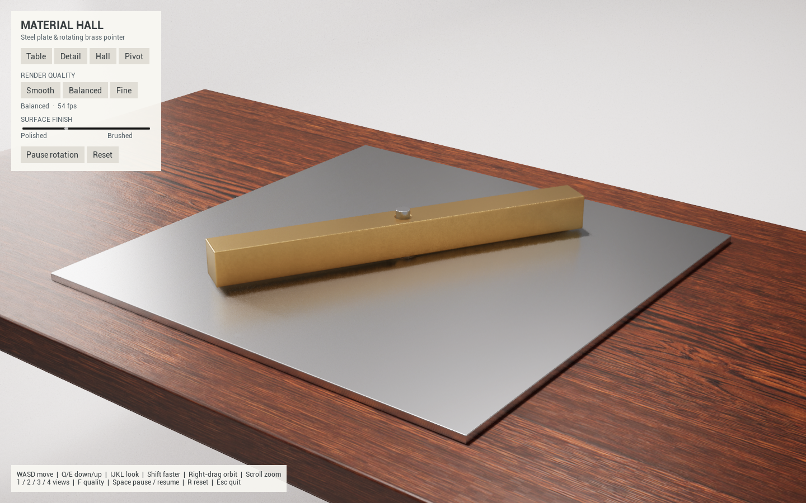

# Mechanism

An interactive Unreal Engine material and mechanism study: a square steel plate
on a walnut table in a bright white hall, with a drilled square brass bar turning
on a central steel pivot. This is the starting point for a mechanical computing
machine simulator.



The pointer rotates once per minute. A real through-hole clears the pin, and a
steel collar supports the bar above the plate. Lighting and reflections use
real-time Lumen. The motion is prescribed animation; a mechanical solver is
future work. Windows PC VR supports Quest 2 over USB Quest Link through OpenXR,
with tracked controllers and a world-space control panel.

## Start on Windows 11

1. Install **Unreal Engine 5.8.4** through Epic Games Launcher, including Windows
   platform support. These assets were saved in 5.8; do not open them in an older
   engine. Blender is not required to run or build the checked-in scene.
2. Install Visual Studio and the C++/Windows SDK components described in
   [the Windows guide](docs/WINDOWS.md#prerequisites).
3. Install Git for Windows. All project assets are included;
   no Git LFS, paid asset pack, or external plugin download is required.
4. From PowerShell in the folder where you keep projects:

```powershell
git clone https://github.com/lukacslacko/mechanism.git
cd mechanism
powershell -NoProfile -ExecutionPolicy Bypass -File .\Tools\build-windows.ps1 -Action Editor
```

Then open `MaterialHall.uproject`, wait for shaders, and choose **Play → Standalone
Game**. To work on C++, generate project files from the `.uproject` context menu
and use **Development Editor / Win64** in Visual Studio.

To build a regular standalone executable:

```powershell
powershell -NoProfile -ExecutionPolicy Bypass -File .\Tools\build-windows.ps1 -Action Package
.\Saved\StagedBuilds\Windows\MaterialHall.exe
```

If the engine is elsewhere, append `-EnginePath 'D:\Epic\UE_5.8'` to the build
command, or set `$env:UE_ROOT` to that directory. See the [Windows guide](docs/WINDOWS.md)
for RTX 5070 hardware ray tracing, packaging, testing, and troubleshooting.

## Quest 2 over USB Link

Connect the headset to the PC, open Meta Horizon Link, and enter **Quest Link**
inside the headset. After packaging, run:

```powershell
powershell -NoProfile -ExecutionPolicy Bypass -File .\Tools\start-quest-link.ps1
```

This selects the installed Meta OpenXR runtime for this process, preserving the
system's runtime selection. After packaging, you can also double-click
`Launch-Quest-Link.cmd` in the repository. `Launch-Desktop.cmd` uses `-nohmd`
so desktop mode works independently of a connected headset.

The right controller points at the panel; its trigger clicks and drags the
finish slider. **A** pauses/resumes, **B** resets the mechanism, **X** moves to
the next of four viewing positions, **Y** shows/hides the panel near your current
view, and the **right stick** snap-turns 45 degrees. Head tracking and room-scale
movement use real-world scale. Resetting the mechanism preserves your position.

VR defaults to TAA and automatic quality. It measures the OpenXR compositor's
display period and targets the headset's current refresh rate, including changes
during a session. The compositor controls synchronization; the desktop 60 fps
cap and monitor VSync are disabled in VR. GPU-based resolution adjusts between
50% and 100% of the runtime's recommended eye resolution, then effects adjust
under sustained load or headroom. Full resolution is restored before effects
rise to Fine. Tuning pauses when the headset loses focus or tracking. Manual
Smooth/Balanced/Fine use 60/80/100% resolution. VR preferences are separate from
desktop preferences. This is a Windows PC build streamed over Link, not an APK.

See [the Windows guide](docs/WINDOWS.md#quest-link-verification) for VR tests.

## Desktop controls

| Input | Action |
| --- | --- |
| W / S | Move forward/back in the direction you are looking |
| A / D | Strafe left/right |
| Q / E | Move down/up in world space |
| I / K, J / L | Look up/down, left/right |
| Shift | Move three times faster |
| Right-drag / scroll | Orbit / zoom |
| 1 / 2 / 3 / 4 | Table / detail / hall / pivot close-up |
| Space | Pause/resume rotation |
| R | Reset pointer and camera; resume rotation |
| F | Cycle Smooth / Balanced / Fine |
| Escape | Quit the game |

The UI also has camera and quality buttons and a shared metal roughness slider.
**Auto 60**, VSync, and TSR anti-aliasing are enabled by default. Auto continuously
adjusts internal resolution between 50% and 100% using Unreal's GPU timings and
a 60 fps budget with spare capacity reserved for frame-time variation. With
sustained spare GPU capacity, resolution rises toward 100% and effects climb to
Fine; sustained overload near the resolution floor reduces effects. Effects
changes have settling periods and a slower recovery threshold to avoid flicker.

Smooth, Balanced, Fine, or the F key select a manual preset and disable Auto.
Manual presets use 50%, 65%, and 85% internal resolution respectively. Click
Auto 60 to resume automatic tuning. The VSync and anti-aliasing buttons toggle
VSync and TSR/TAA independently; these choices persist between launches.
The status shows current quality, fps, resolution percentage, and GPU work time.
Tuning pauses while the app is in the background. A CPU-heavy simulation or a
GPU workload beyond the minimum settings can still fall below 60 fps; the status
reports those limits. Some temporal grain remains in soft shadows and reflections.

## Project layout

- `MaterialHall.uproject`: open this in Unreal; game module name remains `MaterialHall`.
- `Source/MaterialHall/`: native C++ interaction, Slate UI, rotation and runtime tests.
- `Content/MaterialHall/WhiteHall.umap`: complete editable hall and assembly.
- `Content/MaterialHall/Assets/` and `Materials/`: editable imported meshes, textures and material graphs.
- `SourceAssets/`: original FBX meshes and texture maps for reimporting.
- `Tools/`: Windows/Mac build scripts, Blender mesh generators and Unreal Python helpers.
- `docs/ASSETS.md`: dimensions, geometry editing and regeneration.
- `docs/validation/`: recorded verification from the tested Mac build.

Unreal Editor's Python plugins are used only by asset tools. The packaged app
runs compiled C++, and does not need Python, Blender, Xcode or Visual Studio.

## macOS

Install UE 5.8.4 and a compatible full Xcode with its Metal toolchain. Run:

```bash
./Tools/build-mac.sh Package
```

`UE_ROOT` and `DEVELOPER_DIR` can select nonstandard installations. The complete
app is `Saved/StagedBuilds/Mac/MaterialHall.app`; copy that entire bundle.
The script builds and validates in the background without opening the editor.

## Validation status

The original desktop baseline was rebuilt from its clean repository folder, packaged,
rendered and tested on an Apple M2 Pro with macOS 27.0.1 and UE 5.8.4. Its checks covered a complete revolution,
plate/table and collar/pointer contact, fixed pivot alignment, pause/resume,
reset and 13 injected keyboard navigation tests. See the recorded JSON reports
and [pivot close-up](docs/images/pivot.png).

This local Windows build was packaged and runtime-tested with UE 5.8.4 on an
RTX 5070. The adaptive-performance test recovered from 50% to 100% resolution,
raised effects to Fine, and averaged 59.9 fps during its steady sample. The
rotation/control regression and quality-governor automation tests also passed;
local reports are in `Saved/Validation`.

Quest 2 operation over USB Link was confirmed in the headset on 2026-10-21.
The live OpenXR log detected a 72 Hz target and adaptive stereo resolution.
The cooked VR rig test and both tuning-governor automation tests passed, including
simulated 72/80/90/120 Hz pressure and recovery. The initial timed hardware test
ran before tracking became active and did not pass; the later interactive headset
session was confirmed by the user. **RTX hardware ray tracing and the updated
macOS build have not been runtime-tested.**

## License

Original project work is [MIT licensed](LICENSE). The bundled wood textures are
CC0, with their authors and source documented in [THIRD_PARTY_NOTICES.md](THIRD_PARTY_NOTICES.md).
Unreal Engine is installed separately. The VR widget material derives from an
engine material and remains subject to Epic's Unreal Engine license; see
[third-party notices](THIRD_PARTY_NOTICES.md).
